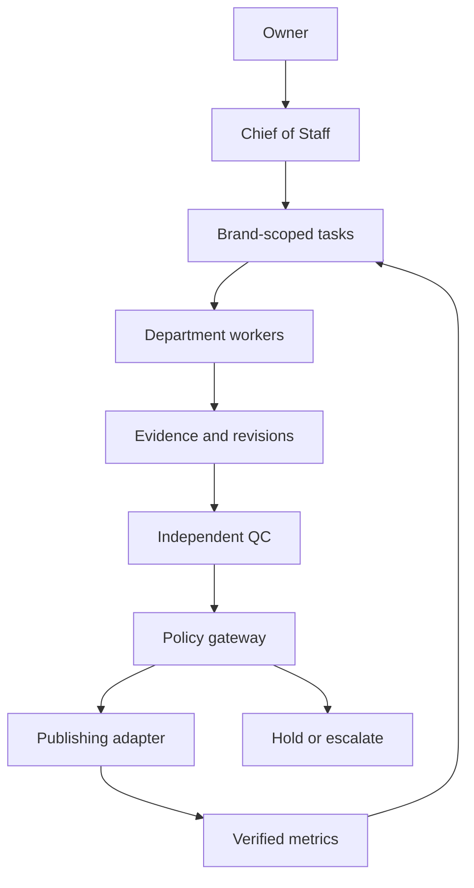

# AI Marketing Agency — Phase 1

Audit date: 2026-11-11. Status: offline architecture and preflight validated; upstream runtime not deployed. This file contains public configuration only. Private asset locations, provider identifiers, analytics, source PMS and credentials remain outside this repository.

## Decision

Use OpenMausBot as the candidate conversation/team harness, with an independent policy gateway and durable task/evidence store before any live tool use. Keep the existing single-brand `workflow.py` pilot for its tested revision/outbox behavior. `agency.py` validates the expanded organization, blocks unverified brand routing, compiles a v1 team manifest and produces rehearsal plans. It does not dispatch models or execute the end-to-end agency pipeline.

Thirty logical roles means one Chief and 29 specialists, not 30 always-running models. Initially compile Chief + seven department leads (eight bots), invoke specialist briefs only when needed, and cap eventual concurrency at two until cost and failure behavior are measured. Compilation does not start bots; eight configured bots do not establish concurrency enforcement in OpenMausBot.

Hotel Operations and Revenue remain reserved read-only advisers from the earlier hotel structure. Performance & Growth owns marketing measurement. Advisers are not extra departments in the requested seven-department agency and receive no guest/PMS access in this phase.



The gateway, durable agency dispatcher, automated receipts and runtime worker limit in this diagram are deployment requirements, not implemented live services. In phase 1 the operator and connected Work tools provide verified actions; the compiler and legacy offline workflow provide local checks.

## Organization and brand routing

`agency.json` is the authoritative role catalog. Every specialist has a focus, inputs, outputs, planned tools and reporting line. It also includes each stage's owner, gate and error behavior.

| Department | Lead | Specialist roles |
| --- | --- | --- |
| Trend Intelligence & Research | Trend Hunter | Trend Hunter, News Scout, Competitor Analyst, Audience Analyst |
| Content Strategy | Content Director | Content Director, Creative Writer, Scriptwriter, Copywriter, SEO Specialist |
| Creative Studio | Art Director | Art Director, Graphic Designer, Typography Designer, Photo Editor, Brand Designer |
| Video Production | Video Director | Video Director, Video Editor, Reels/TikTok Specialist, Music Researcher, Subtitle Specialist |
| Publishing & Community | Publishing Manager | Publishing Manager, Community Assistant, Campaign Coordinator |
| Performance & Growth | Data Analyst | Data Analyst, Viral Content Analyst, Conversion Analyst, Growth Strategist |
| Quality Control | Fact Checker | Fact Checker, Visual Quality Reviewer, Brand & Copyright Reviewer |

Four namespaces: `brands/sapa_wings`, `brands/old_stone`, `brands/3143`, `brands/khong_gian_van_hoa`. Sa Pa Wings is the only enabled rehearsal pilot. Other brand contexts, voice profiles, rights and publishing targets are unverified; their execution requests fail closed. Existing bar assets are provisional evidence, not an approved brand kit.

All future task/evidence/asset/approval/receipt tables must carry `brand_id`; storage queries and adapter target resolution must enforce it, not depend on prompts. The current validator rejects cross-brand evidence; it does not provide database tenancy or authentication. No shared global `voice.md` across brands. Cross-promotion requires two separate briefs and QC for both brands.

## Pipeline contract

| Step | Accountable role | Tools (current or proposed) | Input → output | Gate | Failure behavior |
| --- | --- | --- | --- | --- | --- |
| Research | News Scout | Connected web/Drive reads | Brief → dated source registry | Provenance, date, confidence | Two reads then hold |
| Trends | Trend Hunter | Dated public sources | Registry → ranked hypotheses | Observations vs speculation; rights | Evergreen fallback recorded |
| Brief | Content Director | Local drafting; future task board | Research + brand → objective/audience/format/CTA | One brand; applicable facts | Return incomplete brief |
| Script | Scriptwriter | Local drafting | Brief → bilingual copy/shot list | Claim traceability; timing | Return claims to Research |
| Production | Art Director; Video Director for video | Real Drive media; editable local layout; Canva/Editly pending | Copy + reviewed assets → editable source/render/hashes | Actual render inspected; facilities preserved | Quarantine asset, redo draft |
| QC | Fact Checker + visual + rights reviewers | Source/preview review | Revision → three decisions + seal | All checks pass same revision | Return to specific owner; stop downstream |
| Publishing | Publishing Manager | Metricool via operator; future scoped adapter | Seal + calendar + authority → receipt/readback | Exact revision + target + time; no duplicate | Reconcile timeout before retry |
| Analytics | Data Analyst | Metricool read via operator | Actual post IDs → observations | Publication verified; null ≠ zero | Retry twice; report missing |
| Optimize | Growth Strategist | Local analysis | Comparable data → experiment brief | No invented winner/attribution | Await observation; no automatic spend |

Publishing is paused in the new agency configuration. Prior live schedules are separate existing operations; importing this manifest cannot authorize edits to them. A request, accepted schedule, published post and measured post are distinct states. An item disappearing from the schedule is not publication proof.

Task contract: `task_id`, `brand_id`, `revision`, `stage`, `owner`, input/output/evidence references, state and attempts. QC binds the revision hash, asset hashes and all three review outcomes. Any content or asset change revokes QC. A publish adapter must resolve target from a private trusted brand registry, verify authorization and seal again immediately before writing, use a brand/task/revision idempotency key, and retain/reconcile the provider response. Never retry an ambiguous write blindly.

Future authenticated gateway requirements: verified principal, scoped capabilities, owner authority record (action, brand, channel, revision/campaign, expiry), no ability for a worker to grant itself authority, immutable audit trail and worker separation from tokens. Role strings and JSON booleans are not such a boundary. The offline module accepts operator evidence and cannot establish its authenticity.

## OpenMausBot audit and integration boundaries

Reviewed the fork's README, package manifest, AGENTS.md, SECURITY.md, CLI/MCP/team/self-hosting docs, portable team schema, request-auth implementation excerpt and git-hook installer. Starting upstream snapshot: `613ed01fdc2b04860ef63e3dbdcb46d7e6b1666d` (main as observed). This is a bounded static review, not a clean bill of health, vulnerability scan or full dependency audit.

| Finding | Consequence / decision |
| --- | --- |
| Electron interface, HTTP/SSE harness, CLI engine adapters and team rooms | Suitable orchestration candidate; not a ready-made hotel marketing system |
| Headless team manifest v1; chief and room membership | Compile eight-bot rehearsal manifest; keep legacy `team.json` separate |
| README vs team docs differ about default approval; imported approval may be a suggestion | Explicit `ask`, computer off, browser false; verify actual imported bot permissions before use |
| CLI/native tools may not enforce all declared restrictions | Enforce capabilities outside prompts at gateway/OS level; no Full Access rollout |
| Sessionless loopback Slack worker path documented | Do not enable worker; review auth path before local service exposure |
| Some configuration stores plaintext credentials | Dedicated secret store and scoped process access; no tokens in public repo or task context |
| `prepare` installs git hooks; packaging can fetch native binaries | No upstream install, build or startup during audit |
| Upstream verification requires isolated fake-engine fixture | Mandatory before runtime integration claims; not run in this phase |
| ChatGPT connections belong to Work | They are not inherited by an OpenMausBot process |

### Other repository decisions

All four requested forks exist under `sapawingshotel-ui`, are readable, and have MIT license files. MIT covers code reuse, not rights to photographs, music, fonts, voices or accounts. Findings below are based on sampled files, not full code audits.

| Repository | Evidence reviewed | Decision |
| --- | --- | --- |
| [ShortGPT](https://github.com/sapawingshotel-ui/ShortGPT) | README, requirements.txt, Dockerfile, LICENSE | Defer. External media/TTS/model services; several dependencies unpinned; Dockerfile includes `printenv`. Remove environment dump, pin/audit dependencies, review model spend and media sourcing before isolated tests. Never use internet footage as hotel truth. |
| [editly](https://github.com/sapawingshotel-ui/editly) | README, package.json, LICENSE | Candidate renderer after audit. ffmpeg/native canvas/GL; `prepare` invokes Husky. Use vetted local assets, remote requests false, reject arbitrary JS/custom command fields, restrict paths and isolate rendering. Not installed or executed. |
| [social-media-skills](https://github.com/sapawingshotel-ui/social-media-skills) | README, license, graphic-designer and niche-research instructions | Selective reference for evidence, scripts and editable layouts. Not an account connection or complete agency. LinkedIn-oriented patterns must be adapted to hospitality and each brand voice; do not copy author identity, global profile or image generation defaults. Not installed. |
| [instagram-agent-skill](https://github.com/sapawingshotel-ui/instagram-agent-skill) | README, license, ig-reel instructions and hookscore.py excerpt | Draft/research reference. It does not publish. Hook regex/wordlists are English oriented and cannot be adopted as Vietnamese QC or performance prediction. Platform rules in repository text need current official verification before use. Not installed or executed. |

No remote installer or external skill instruction was executed. Retrieved instructions are audit evidence. Entire lockfiles, transitive dependencies, every script, secret exposure and runtime network behavior remain to be checked before service startup.

## Real-image design and evidence policy

Use existing real hotel media with source and checksum; archived images need visible disclosure and cannot establish current room condition or room type. Never generate or alter facilities. Boutique direction: restrained color, generous whitespace, serif/sans hierarchy, legible mobile CTA and editable source. The current direction is provisional, not a claimed owner-approved brand kit. Benchmark Đà Lạt/Hội An/Phú Quốc from dated source examples before finalizing templates; this phase has not completed that design study. Inspect Vietnamese marks and font/music rights on the rendered result.

Do not derive live prices or policies from historical documents. PMS stays unchanged. No guest names, IDs, booking records or raw exports in marketing context. Conversion measurement remains unverified until a campaign-to-booking attribution source exists. Do not equate revenue, payments and profit, or post-reach sums with unique people.

## Reproduce the local checks

From repository root, with Python's standard library only:

```bash
python3 -m unittest discover -s sapawings/tests -v
python3 sapawings/agency.py validate
python3 sapawings/agency.py plan --brand sapa_wings --task boutique-pilot
python3 sapawings/agency.py manifest > /tmp/sapawings-agency-team.json
```

Expected phase-1 suite: 22 tests (12 legacy workflow + 10 agency preflight). Tests cover brand isolation, inactive brands, unsafe policy changes, missing/duplicate assignments, QC routing, namespace collision, deterministic task keys, rehearsal-only states and the generated team structure, in addition to legacy revision/outbox checks. They do not prove upstream import, model behavior, real rights, live API auth, multi-tenant persistence or actual publication.

Do not import the generated manifest into an existing team unattended: import may change configuration and needs permission-state verification. `team.json` is the earlier seven-role hotel pilot; the generated manifest is the new eight-bot marketing rehearsal. Neither has been applied to a running service.

## Completion and next gates

Completed: connection audit, bounded architecture/security review, 30-role machine-readable catalog, four namespaces, nine stage contracts, offline validator/planner/compiler, regression checks. Source changes remain in a draft PR, not merged or deployed.

Not completed: full dependency audit, authenticated gateway, persistent multi-brand queue, model dispatcher, running OpenMaus fixture, live runtime adapters, installed personal Skills, dashboard, Canva integration, brand-kit study, automated video and booking attribution. Existing Work schedules and measurement reminders are not an always-on OpenMaus agency.

Next phase: finish pinned dependency review and isolated fake-engine fixture; then provision a dedicated runtime with no PMS mount and scoped secrets, verify imported permissions, implement authenticated capability/receipt gateway, and run one full Sa Pa Wings revision through draft/QC with external writes disabled. Request owner input only for genuinely new access, spend, important changes or publication beyond scoped authority. Canva account connection is optional for this phase; Notion is not a prerequisite, since an isolated task store can be introduced before any dashboard. No permission is needed merely to continue source review and local implementation.

## Stage 2 status

See [STAGE2.md](STAGE2.md) for the persistent authenticated local task rehearsal, 38 passing tests and dependency findings. Upstream fixture execution is blocked by unresolved version-matched advisories. The local token/capability boundary is not a deployed authenticated service; no model, live publishing or PMS adapter exists. Earlier phase-1 limitations remain historical context except where STAGE2.md describes the implemented local store.

## Stage 3 status

[STAGE3.md](STAGE3.md) covers versioned brand memory, memory-bound task/QC checks, 51 passing local tests, all 17 affected-version dependency paths and a focused root undici 8.12.2 patch. Upstream execution remains blocked. Memory/task databases are separate local transactions; live publication requires serialized authorization and immediate memory revalidation. No model or live publication adapter has been deployed.
